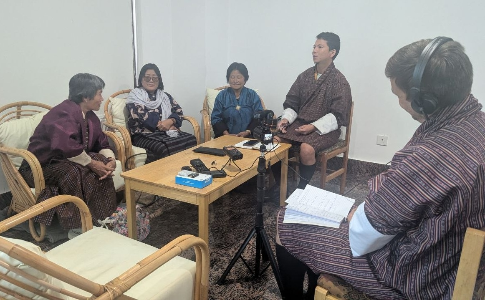
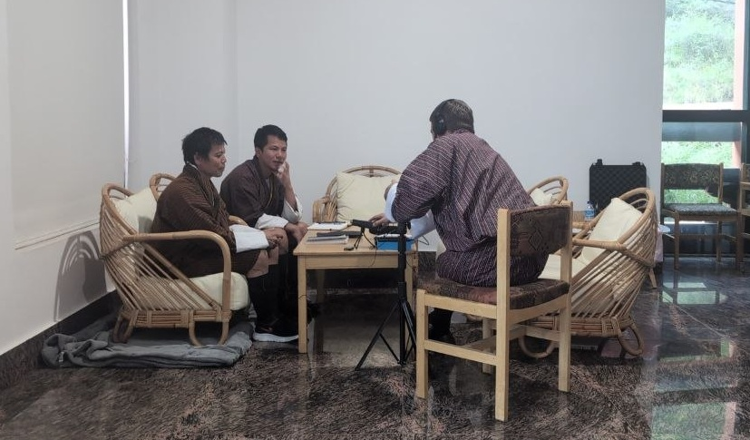
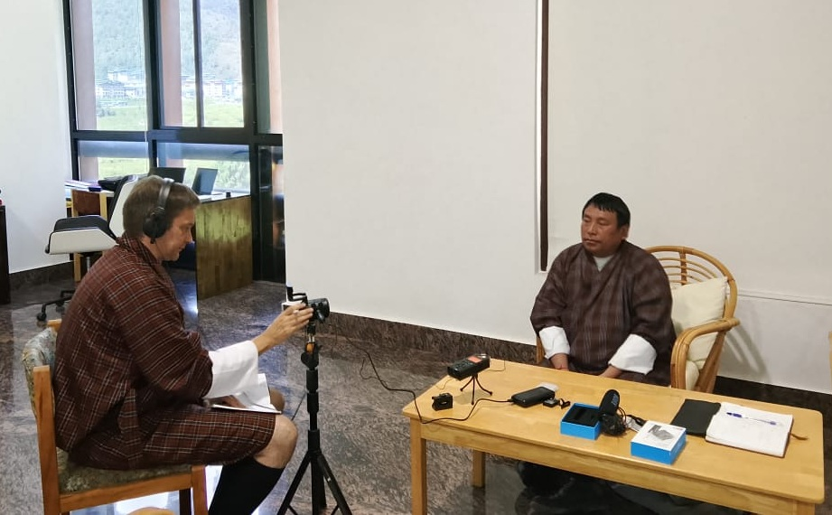
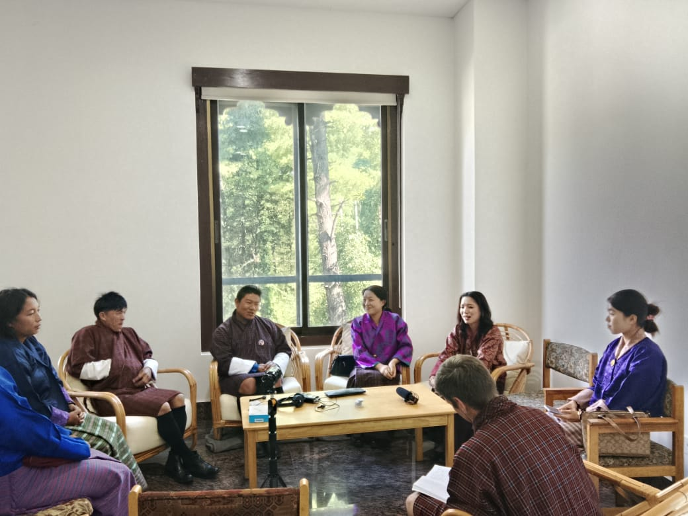

# Documenting Gongduk with Speakers in Thimphu

**06 October 2026**

From October 6th, 2026, onwards, Tim and Rinchen have been holding discussions and making recordings with the large Gongduk-speaking population living in Bhutan’s capital, Thimphu. Our survey results show that of the 1261 Gongduk mother tongue speakers, around 32% lives in the home village, with another 8% living in other Gongduk villages in the gewog. This means that only 40% of the Gongduk speakers forms part of what could be considered a Gongduk speech community. In contrast, 56% lives scattered in towns and villages elsewhere in Bhutan, with 50% of those, or 350 people, living in Thimphu. Less than 4% of the Gongduk mother tongue speakers, or 50 people, live abroad. 

The Gongduk community in Thimphu is a very diverse group, including elderly people, often living there with their children, civil servants, people employed in the security forces and private business, students, and monks. Some left their native village relatively recently, whereas others have already spent several decennia outside Gongdue gewog. While they all consider Gongduk their mother tongue, the level of proficiency is highly dependent on the individual’s life history and educational and professional profile. Most notably, in mixed marriages, the Gongduk spouse almost unequivocally linguistically assimilates to the non-Gongduk spouse, not transferring the language to their children. While there is a community association in Thimphu that brings together people, mainly during bereavements, there is not a real community focusing on the preservation and promotion of the language. Many speakers were engaged with their professional and personal lives, and so we are very grateful to the people who managed to set aside a day or even a couple of hours to interact with us and share their stories, their views and their ideas.

Here are some photographs from the Gongduk documentation sessions in Thimphu.

  <figure>
    
    <figcaption>
      Eliciting verbal agreement with Dorji Dema (64), Tshewang Lhamo (49) and Sangay Lhamo (60), originally from Daksa and Gungdu.
    </figcaption>
  </figure>

  <figure>
    
    <figcaption>
      Recording narratives from Tshewang Gyeltshen (64), originally from Bakla.
    </figcaption>
  </figure>

  <figure>
    
    <figcaption>
      Recording narratives from Rinchen Wangdi (57), originally from Bogarbi.
    </figcaption>
  </figure>

  <figure>
    
    <figcaption>
      Holding a discussion with speakers in their 20s and 30s originally from Daksa, Miden, Bangbangla, Bakla, Weringla and Gungdu villages.
    </figcaption>
  </figure>

