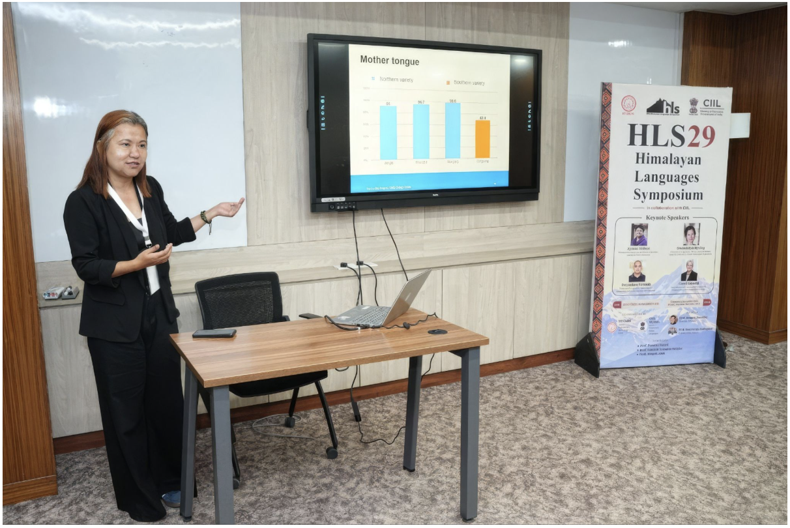
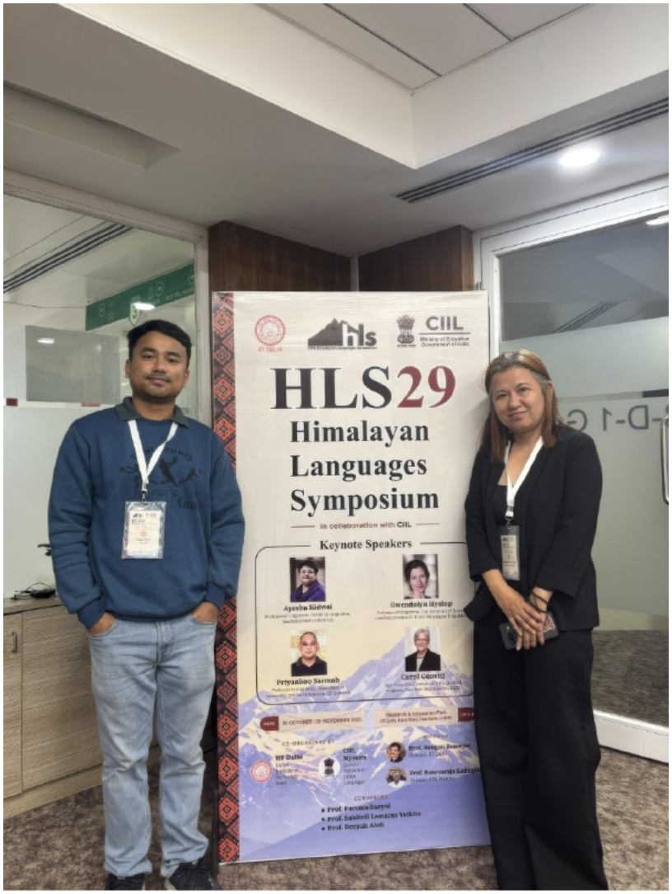
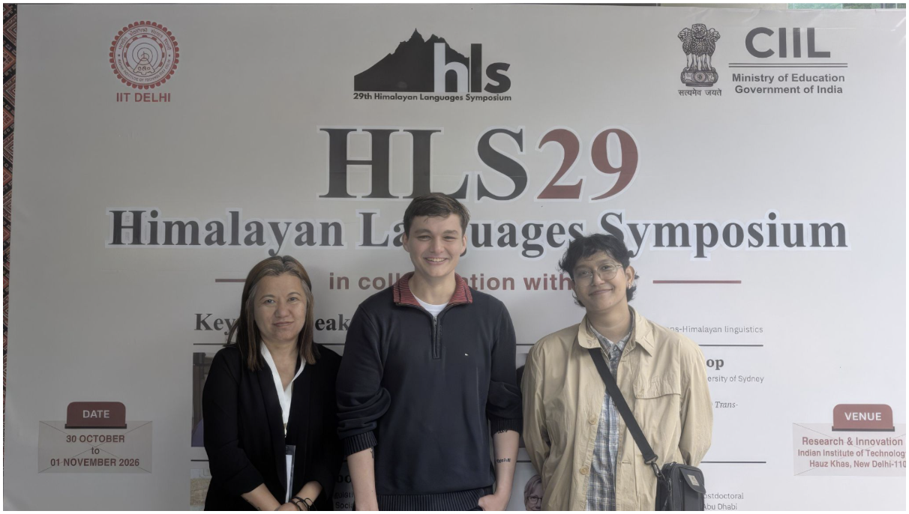

# Lo-Rig Research Presented at the 29th Himalayan Languages Symposium

**01 November 2026**

Tshering Om Tamang presented her paper, "Sociolinguistic Survey of 'Ole': Setting the Record Straight", at the 29th Himalayan Languages Symposium (HLS-29), held from 30 October to 1 November 2026 at the Indian Institute of Technology (IIT) Delhi, New Delhi, India. Drawing on sociolinguistic survey data collected from the Monpa communities of Cungseng, Riti, Jangbi, Phumzur and Wangling in Bhutan, the presentation examined language use, mother-tongue identification and the sociolinguistic situation of Monkha. The symposium brought together researchers and linguists working on Himalayan languages, providing an opportunity to share research and engage in discussions on linguistic diversity, language documentation and preservation.

<figure markdown>
{ width="85%" }
<figcaption>
Tshering Om Tamang presenting her sociolinguistic survey of the Monpa communities
</figcaption>
</figure>

During the closing session on 1 November 2026, a pre-announcement was also made for the 31st Himalayan Languages Symposium (HLS 2028), which will take place in May 2028 in Gleann Cholm Cille, County Donegal, Ireland. The symposium will be co-hosted and co-organised by the Lo-Rig Project and Oideas Gael, with support from the Trinity Long Room Hub and the Trinity Centre for Asian Studies.

<!-- <figure markdown>
{ width="55%" }
<figcaption>
Tshering with other HLS29 participants
</figcaption>
</figure>

<figure markdown>
{ width="85%" }
<figcaption>
Tshering with other HLS29 participants
</figcaption>
</figure> -->
