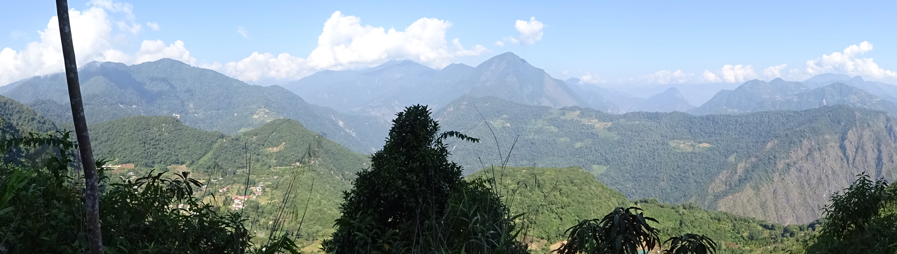
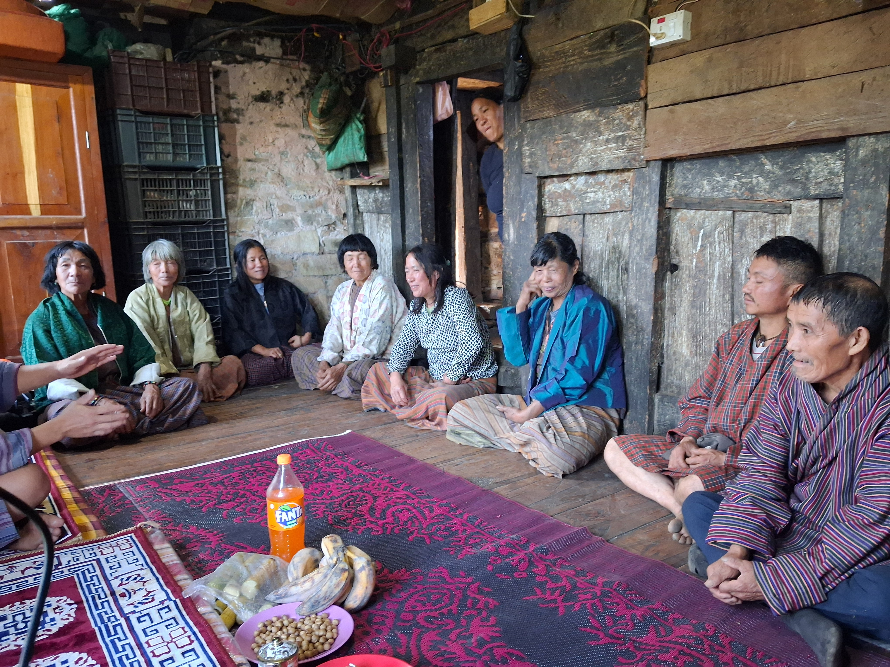
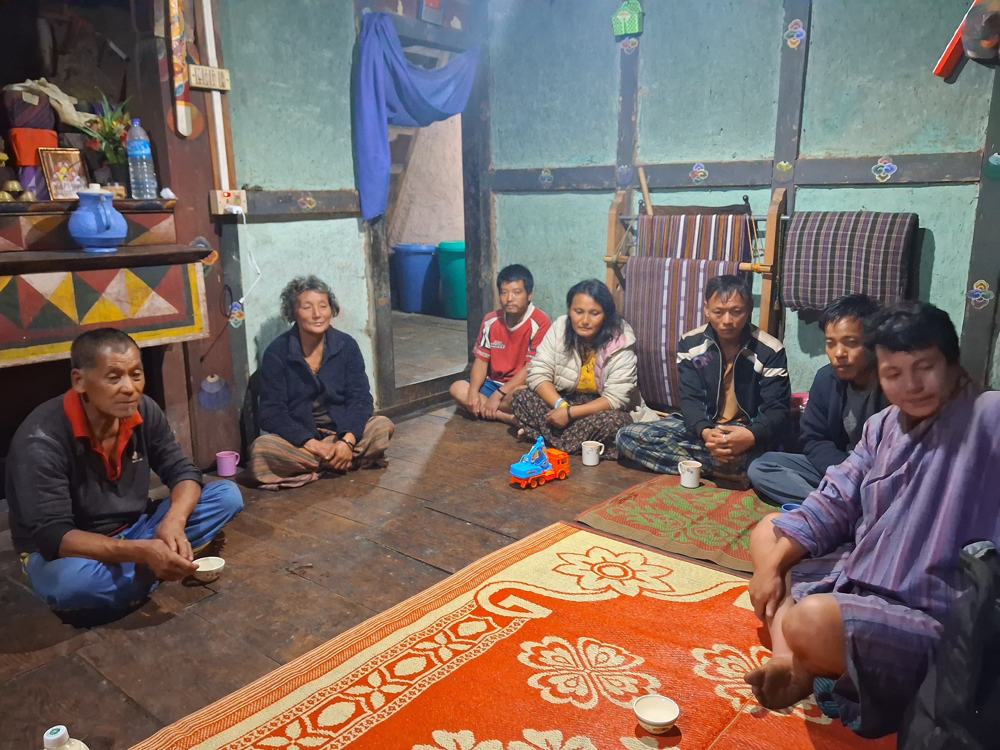
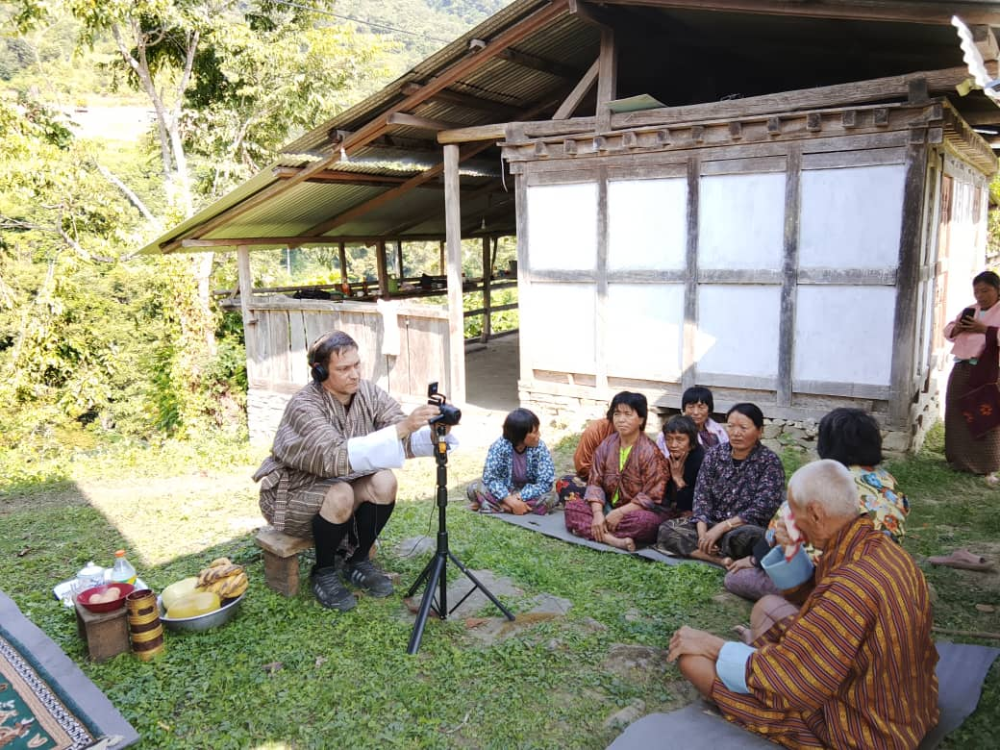
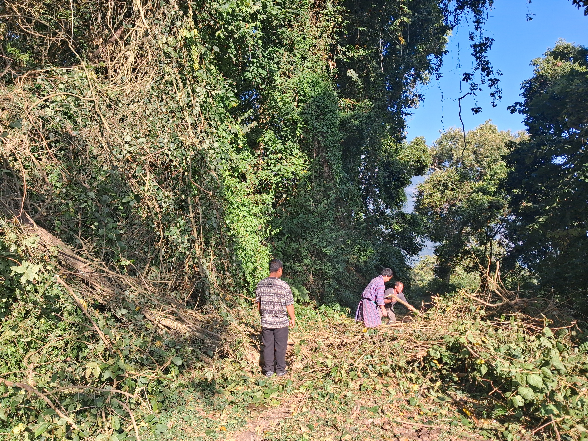
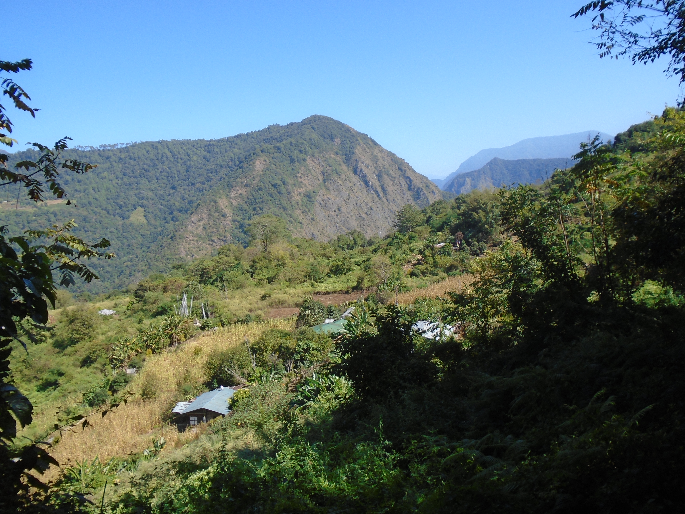
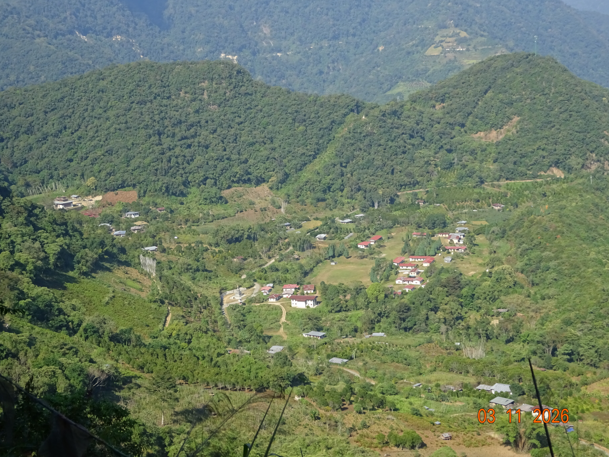
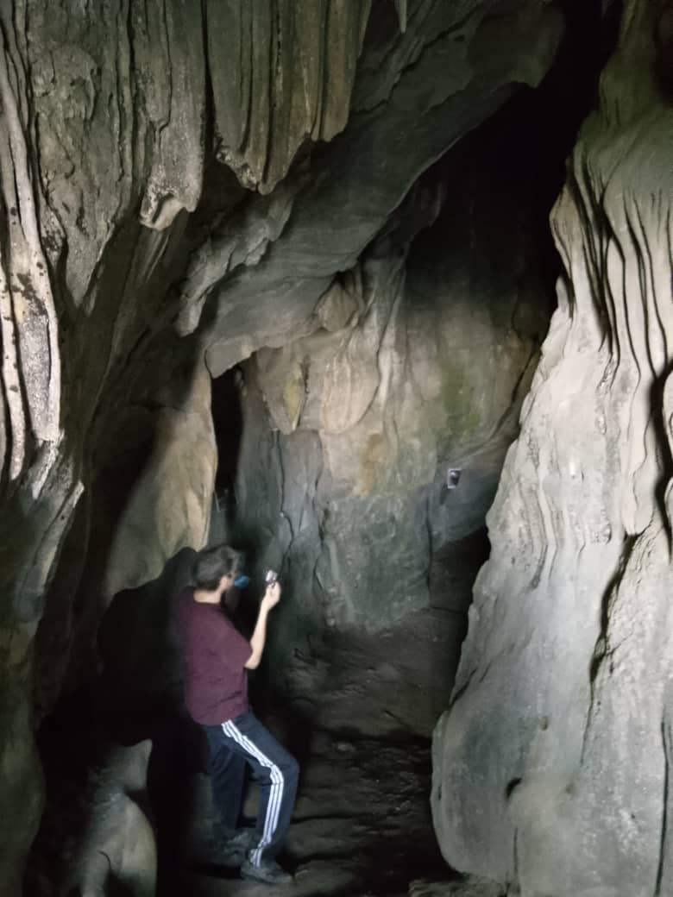

# Gongduk Data Collection in the Field

**18 November 2026**

After successfully recording Gongduk speakers living in Thimphu, the PI Tim and RA Rinchen have been conducting fieldwork in Gongdue gewog (block) of Mongar dzongkhag (district) in eastern Bhutan, the traditional home of the Gongduk people.

<figure>
  
  <figcaption>Overview of the Gongduk speech area.</figcaption>
</figure>

## Community consultations and recordings

Tim and Rinchen traveled widely across the gewog, visiting the villages of Pangthang, Gongde, Toekor, Damkhar, Domong, Salibi, Tshabor, Phosala, Midan, Pam, Gorthongla, Gongdu, Daksa, Pikari, Bakla and Idi. In each village, they held a group consultation meeting and obtained community consent for data collection, archiving and publication as per the prescribed protocol. They also updated the sociolinguistic survey of the Gongduk-speaking population.

They then mainly recorded the most elderly speakers, collecting a total of 14 1/2 hours of recordings of various genres. Nearly 2 hours are the recorded consent sessions; a little over 2 hours are elicitation of minimal pairs; almost 3 1/2 hours are discussions about livelihoods in past and present, including foraging, agriculture, domestic animals, wild animals and their impact on humans, climate change, and handicrafts; almost 1 hour consists of narratives such as fables and stories; 1/2 an hour consists of personal narratives and experiences; almost 1/2 an hour consists of discussions about the sociolinguistic status of Gongduk; and a little over 5 hours are historical narratives, including about local deities, religious practices and landmarks, the settlement history of the area, taxation in the past, etc. Some recordings are monologues, others are question-and-answer sessions, dialogues, and group discussions.

  <figure>
    
    <figcaption>Community consultation meeting in Midan village.</figcaption>
  </figure>
  <figure>
    
    <figcaption>Community consultation meeting in Pam village.</figcaption>
  </figure>
  <figure>
    
    <figcaption>Recording session at Damkhar village.</figcaption>
  </figure>
  <figure>
    
    <figcaption>Removing a tree that had fallen on the road between Pam and Gorthongla villages.</figcaption>
  </figure>

## The community and language transmission

Tim and Rinchen consulted 32 females and 26 males, ranging in age from 33 to 88 years old, with the majority in their mid-fifties, sixties and early seventies. This age range reflects the average age of the population in the gewog, which has seen a massive outward migration of the educated population. The arrival of basic necessities, such as electricity, drinking water supply and roads, since 2015-2020 was too late to stem this migration, and education, health and extension facilities have since been reduced due to a lack of population and pupils.

In addition, historical inward migration in the Damkhar-Pangthang area has reduced the Gongduk-speaking population there, with many households shifting to Khengkha and Tshangla except for in Damkhar village itself. 

This lack of a viable speaker community allowing the transmission of the language to the next generation was identified as the largest threat to the viability of Gongduk. Speakers observed that once people move out of Gongduk gewog, and once people marry people outside the Gongduk speech community, they cease to speak the language on a daily basis, and they do not transfer the language to their children.

With the 2,640 MW Kuri-Gongri hydroelectric project coming up in the Kuri-Gongri River, that flows to the East of Gongdue, the gewog is expected to witness further change soon. While the Yangbari-Tshobaley-Telung area will see the largest influx of (temporary) workers and associated facilities, there is some hope that the Daksa Primary School will be upgraded to function as a catchment school for the area. This would enable Gongduk-speaking children to access education in a Gongduk-speaking area and may facilitate language transmission.

## Landscapes and locations

  <figure>
    
    <figcaption>View of Gongdu village.</figcaption>
  </figure>
  <figure>
    
    <figcaption>View of Daksa, the Gongdue gewog headquarters, including the gewog office, basic health unit and primary school.</figcaption>
  </figure>

<figure>
  
  <figcaption>The upper cave at the Toekor cave complex. Caves in the area contain stalactites and stalagmites, extend deep into the mountains, and are home to bat colonies.</figcaption>
</figure>

## Next steps

A follow-up field visit in January 2027 will survey the remaining villages of Bangbangla, Bogarbi, Kumadzong and Laptsa and collect wordlists, verbal agreement paradigms, and additional natural speech.
